# SessionSift

SessionSift is a local-first conversation profiler for Codex, Claude Code,
ChatGPT, and Claude. It imports live and archived Codex transcripts, live Claude
Code transcripts (including subagents), and user-provided ChatGPT and Claude.ai
data exports, normalizes activity into SQLite, and shows where tokens, context,
tools, retries, and corrections accumulated. Its findings link back to observed
evidence; it does not assign a productivity score.

The trusted Go process is the Local Agent product boundary. React, CLI, and
future MCP clients consume the same allowlisted, versioned Session Protocol;
provider parsers and SQLite are not client-facing interfaces.

## Screenshots


One session in the **Conversation** lens. Each prompt's tool calls fold into a
run; a failure later followed by a success is labelled, and the inspector shows
the selected call's redacted evidence. All screenshots use synthetic demo data.

<details>
<summary>More screenshots: timeline, tools, review, sharing, pages, dark theme and phone</summary>

<table>
<tr>
<td width="50%">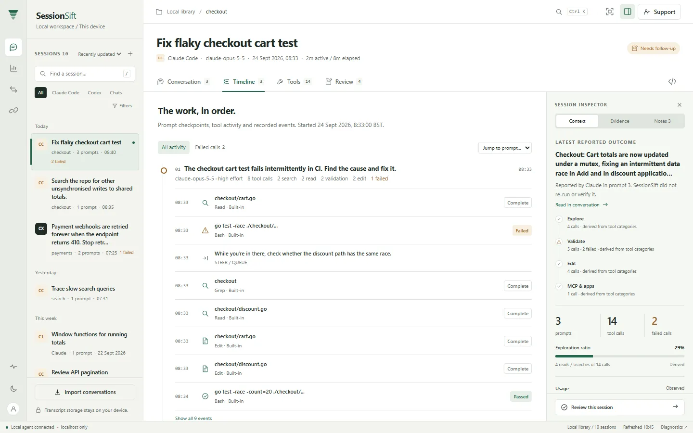<br><b>Timeline</b>: each prompt's checkpoint with up to eight entries; failures are always kept.</td>
<td width="50%">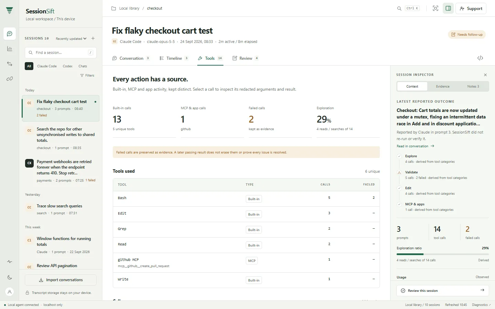<br><b>Tools</b>: tools grouped by name and transport, and every call.</td>
</tr>
<tr>
<td>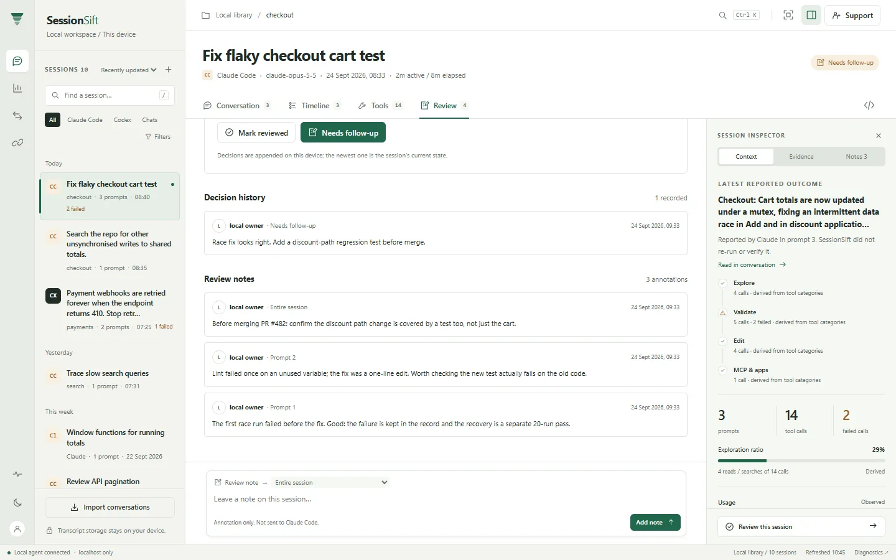<br><b>Review</b>: decisions and notes stay on this device and never reach the agent.</td>
<td>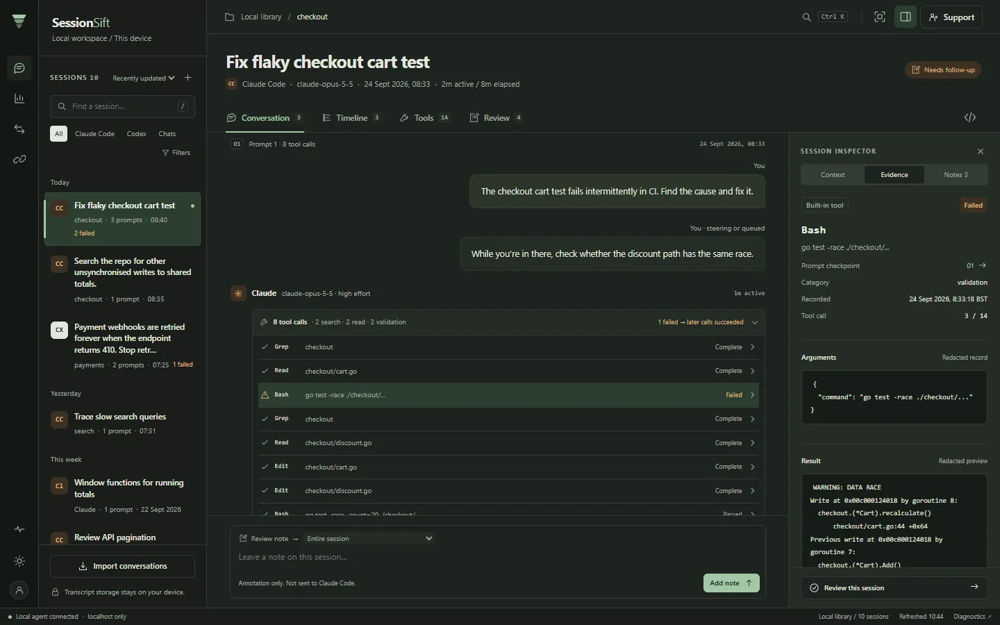<br><b>Dark theme</b>: follows the system unless you choose one.</td>
</tr>
<tr>
<td>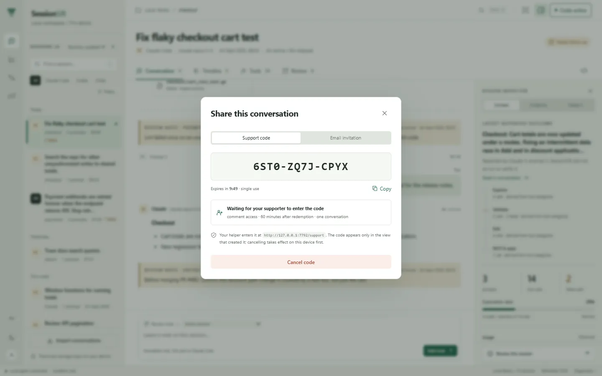<br><b>Support code</b>: generated on this device for one session and one role.</td>
<td>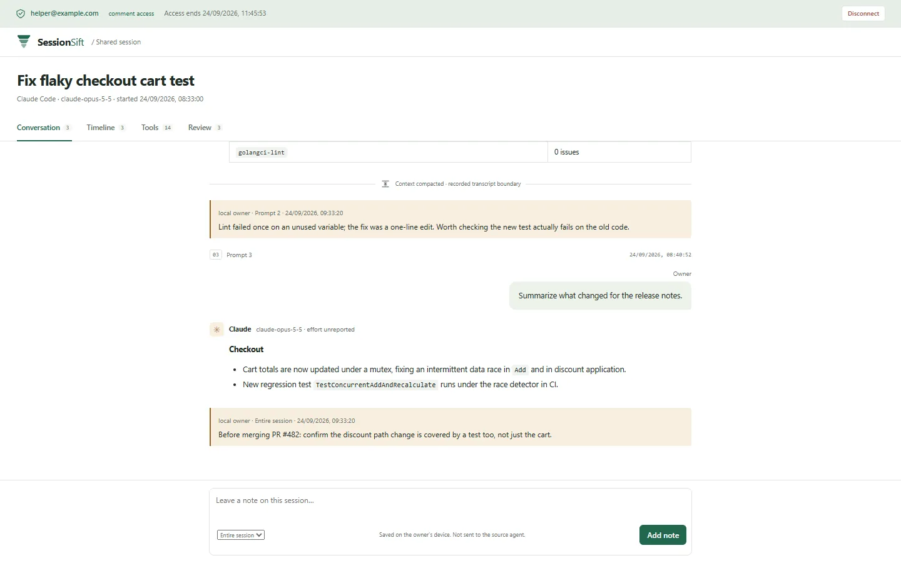<br><b>Helper view</b>: what the supporter sees on the bridge, limited by the grant.</td>
</tr>
<tr>
<td>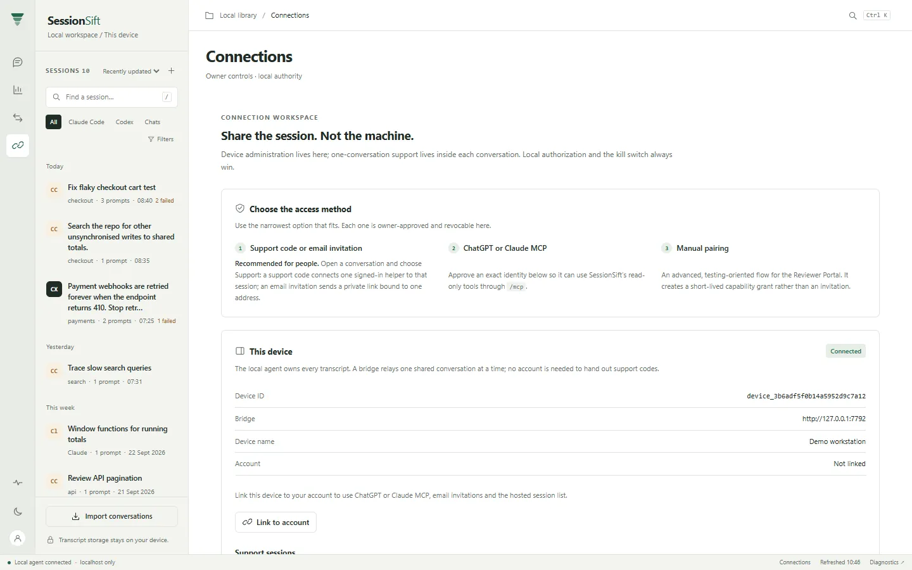<br><b>Connections</b>: which access method to use, the bridge, MCP identities and pairing.</td>
<td>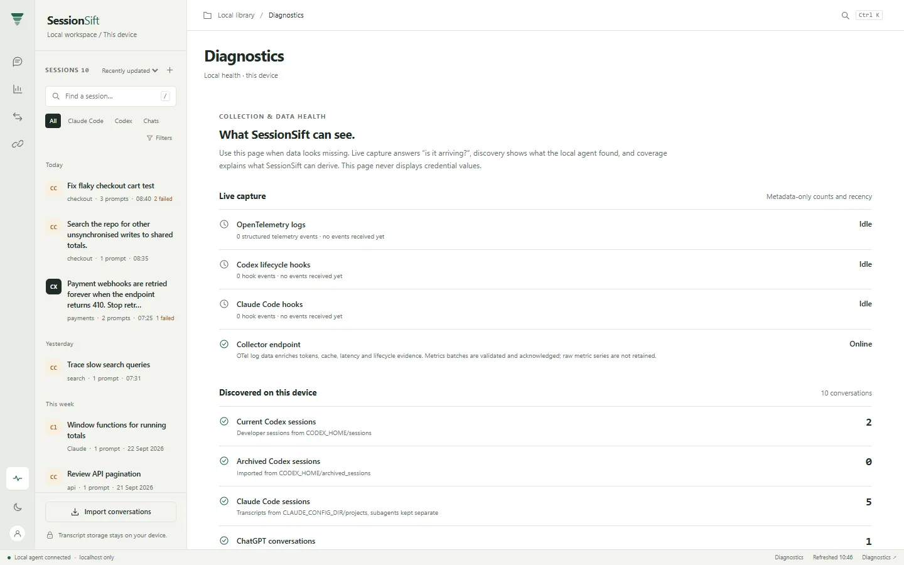<br><b>Diagnostics</b>: whether capture is arriving and what the agent found.</td>
</tr>
<tr>
<td>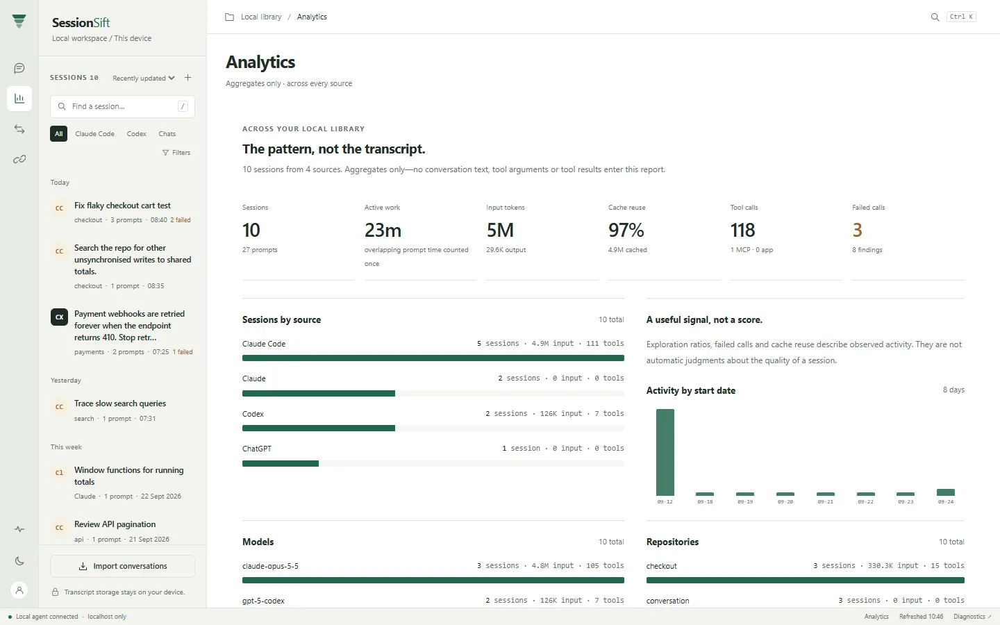<br><b>Analytics</b>: aggregates only, no conversation text.</td>
<td>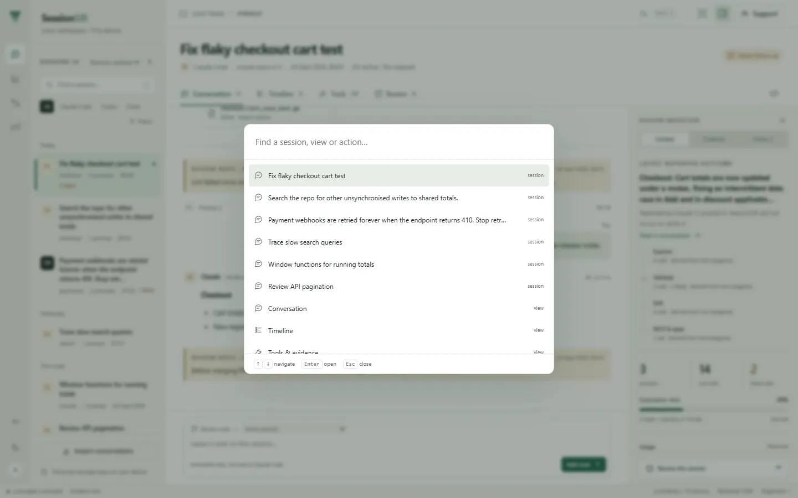<br><b>Command palette</b>: <code>Ctrl/Cmd K</code> for sessions, lenses and actions.</td>
</tr>
<tr>
<td>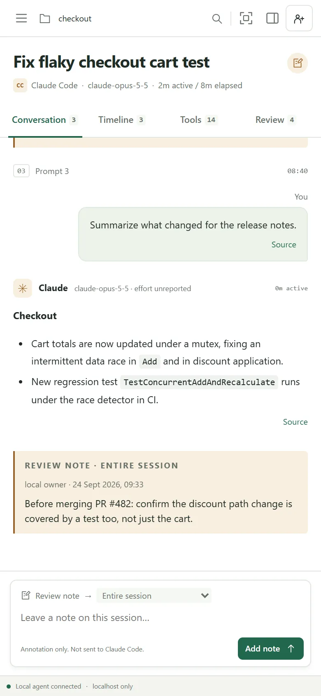<br><b>Phone</b>: the same conversation at 390px.</td>
<td>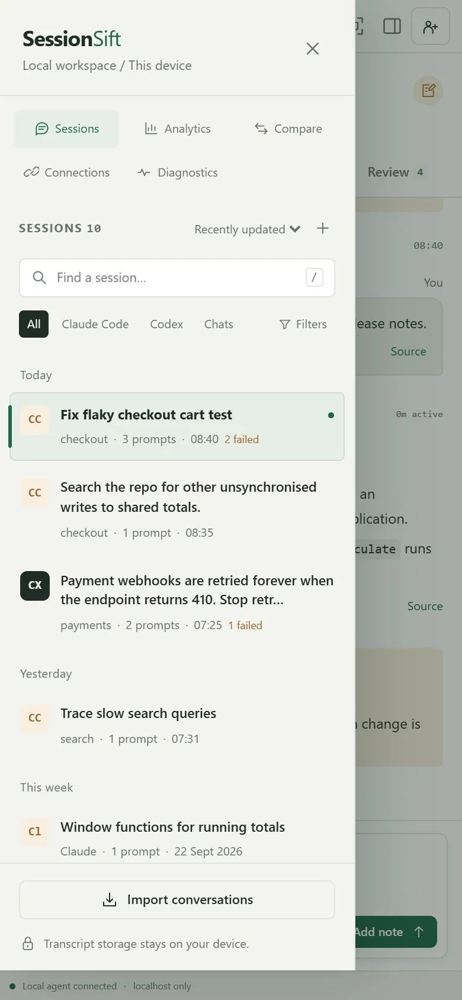<br><b>Phone library</b>: pages and sessions in one drawer.</td>
</tr>
</table>

</details>

## Quick start

Requirements: Go 1.27+ and Node.js 22+.

```bash
npm install
npm run build
./dist/sessionsift import
./dist/sessionsift start
```

Open <http://127.0.0.1:7777>. SessionSift imports
`$CODEX_HOME/sessions` and `$CODEX_HOME/archived_sessions` (normally under
`~/.codex`) and Claude Code's `$CLAUDE_CONFIG_DIR/projects` (normally
`~/.claude/projects`). Re-running `import` processes only changed transcript
files. Starting the app also watches those directories and refreshes changed
sessions every three seconds.

Do not route a public tunnel to this port. Public deployments run the separate
connection bridge on port 7780; the Local Agent stays on loopback and polls the
bridge outbound.

The main commands are:

```text
sessionsift start
sessionsift bridge
sessionsift agent connect <bridge-url> [device-name]
sessionsift agent link [--no-wait]
sessionsift agent share <email> [days]
sessionsift agent revoke <email>
sessionsift agent status
sessionsift support start <session-id> [view|comment|review] [minutes]
sessionsift support list
sessionsift support end <support-id>
sessionsift stop
sessionsift status
sessionsift backup
sessionsift import
sessionsift import-chatgpt <export.json-or-zip>
sessionsift import-claude <export.json-or-zip>
sessionsift sessions
sessionsift inspect <session-id>
sessionsift compare <session-a> <session-b>
sessionsift mcp
sessionsift doctor
sessionsift setup enable [claude]
sessionsift setup hooks
sessionsift setup claude
sessionsift setup otel
sessionsift setup chatgpt
sessionsift setup mcp
sessionsift setup undo
```

## Claude Code and Claude conversations

Claude Code transcripts are discovered automatically; each subagent transcript
becomes its own session so it never overwrites its parent. Titles follow Claude
Code's renamed title, then its generated title, then the first prompt. Thinking
text is never stored. Claude reports cache reads separately; SessionSift counts
them inside input tokens and as the cached share so cache ratios compare across
providers, and each API response's usage is counted once.

`sessionsift setup enable claude` merges SessionSift's non-blocking hook into the
`hooks` object of `~/.claude/settings.json` (every other byte is preserved;
symlinks and invalid JSON are refused). `sessionsift setup claude` prints the
same settings, the Claude Code MCP command, and export instructions for review.

For Claude.ai, request an export from **Settings → Privacy → Export data**, then:

```bash
sessionsift import-claude ~/Downloads/claude-export.zip
```

Only the conversations JSON is read; account, profile, and project files in the
export are ignored. Attachment contents are not imported, only their count and
file names. The path is remembered and re-imported when replaced
(`SESSIONSIFT_CLAUDE_EXPORT` overrides it).

## ChatGPT conversations

Request a ChatGPT data export from **Settings → Data Controls**, then import the
downloaded ZIP directly:

```bash
sessionsift import-chatgpt ~/Downloads/chatgpt-export.zip
```

`conversations.json` and numbered `conversations*.json` files are also accepted.
SessionSift remembers the selected private local path and checks it for changes
every five seconds while running. Replacing that file with a newer export updates
the imported conversations. `SESSIONSIFT_CHATGPT_EXPORT` overrides the remembered
path. SessionSift does not scrape a ChatGPT account or read browser credentials.

ChatGPT exports do not always include token counts or every internal tool detail;
unavailable measurements remain zero rather than being estimated.

## Tools and MCP

The inspector groups every observed tool name and reports executions, failures,
transport, and MCP server. Built-in tools, MCP calls, and app/connector calls are
counted separately. Turn detail retains bounded redacted arguments and result
previews when the source records provide them.

The chat transcript, conversation timeline, and tools-used panels are fixed-height
scroll regions. Each opens at the latest activity and provides prompt checkpoint
buttons for jumping back through a long session.

`sessionsift mcp` runs the ten-tool, read-only local MCP server over stdio,
including privacy-safe aggregate analytics, recurring-correction patterns, and
context recommendations.
`sessionsift setup mcp` prints ready-to-review Codex, Claude Code, and Claude
Desktop configuration. Session
lists page explicitly and tool responses stay bounded and redacted. See the
[MCP connection guide](docs/mcp-connection-guide.md) for local and scoped remote
clients.

## Remote support and collaboration

Connections work like remote-support tools: **the machine with the sessions
generates the code, and the other person types it in.**

1. Connect this device once: `sessionsift agent connect https://YOUR-BRIDGE` (or
   **Connections → Connect this device**). No account is needed.
2. Open a conversation, choose **Support** in the top bar, then **Generate support code** (or
   `sessionsift support start <session-id>`). You get a code like
   `7Q4M-2KXH-9TRD` that expires in ten minutes and works once.
3. Your supporter signs in at `https://YOUR-BRIDGE/support`, enters the code, and
   lands directly in that one conversation — nothing else on your machine is
   reachable. Your device verifies the code itself before access starts.
4. You see who is connected and can **Disconnect supporter** at any time; access
   also ends when its chosen length (5 minutes to 8 hours) runs out.

To use your own sessions from ChatGPT or Claude MCP, email invitations, or the
hosted session list, link the device to your account with
`sessionsift agent link` and enter the code it shows under **Add a device** at
`/`. The device owner grants or revokes an exact email locally with
`sessionsift agent share` and `sessionsift agent revoke`; grants are short-lived,
read-only, and operation-scoped.

Annotations and review outcomes are redacted, capability-scoped collaboration
records. The provider-neutral bridge uses outbound polling and signed device
responses, so a deployment does not expose the workstation or provider
credentials. See [remote architecture](docs/remote-architecture.md). The bundled
bridge persists its queue and registry in a private SQLite database.

The public `/mcp` path uses the official MCP SDK, current protocol negotiation,
Cloudflare Access signed identity, and a separate locally approved email grant
for OAuth-capable MCP clients such as ChatGPT and Claude. Google can remain the
upstream Access login provider while Cloudflare Managed OAuth supplies OAuth
discovery, dynamic client registration, consent, token issuance, and refresh
tokens. Dynamic client registration happens at Cloudflare's authorization
server, not inside SessionSift; SessionSift acts as the protected MCP resource
and verifies the resulting Cloudflare Access identity before applying its own
local email grant. Each client callback URI must be allowed in the Cloudflare
Managed OAuth application (for example, ChatGPT's connector callbacks and
Claude's `https://claude.ai/api/mcp/auth_callback`). See the
[deployment guide](docs/deployment.md) for the required routes and settings.

ChatGPT transcript import remains fully supported through user-provided exports
and is independent of ChatGPT MCP access.

## Live events

`sessionsift setup enable` safely merges SessionSift lifecycle hooks into
`~/.codex/hooks.json` and local OTLP log and metrics exporters into
`~/.codex/config.toml`. It is idempotent and refuses to replace symlinks or an
existing, different `[otel]` section. `sessionsift setup hooks` and
`sessionsift setup otel` print the same settings for manual review. The hook
command has a 40 ms localhost budget and falls back to private files under
`~/.sessionsift/raw/events`; those files are replayed on the next start and
removed after successful persistence.

Codex requires unmanaged hooks to be reviewed and trusted after installation;
open `/hooks` in Codex to complete that approval. The OTLP configuration keeps
prompt logging disabled. SessionSift validates standard binary and JSON
OTLP/HTTP log and metrics batches, retains only redacted attributable log
metadata, and uses attributable token measurements to refine turn metrics.
Transcript imports remain the authoritative session history and hooks provide
the lowest-latency activity.

## Titles, context, and navigation

For Codex sessions, the user-assigned thread name from the read-only local Codex
state index takes precedence over the first prompt. The inspector shows the
observed start time, client/surface, thread source, approval mode, sandbox,
network policy, and a clearly labeled derived local/remote classification when
the source supports it. Later user messages observed in the same turn appear as
`STEER / QUEUE`; the available local records do not reliably distinguish those
two delivery modes, so SessionSift does not guess.

The web UI is a conversation-first workspace. A narrow rail switches between
Sessions, Analytics, Compare, Connections and Diagnostics; the session library
lists every source, most recently updated first (or by creation, title or input
tokens), with search and source filters. A session opens
in four lenses — **Conversation**, **Timeline**, **Tools** and **Review** — beside
an inspector whose **Context**, **Evidence** and **Notes** tabs follow whatever
call, prompt, file or finding you select. Review notes and decisions are local
annotations: they never modify the transcript and are never sent to the source
agent. `Ctrl/Cmd K` opens a command palette, `Ctrl/Cmd Shift F` toggles focus
mode, `/` searches the library, and the rail switches light and dark themes.

Screens use History API navigation and deep links such as `/sessions/<id>`,
`/sessions/<id>/timeline`, `/compare`, `/analytics`, `/connections`, and
`/diagnostics` without page reloads; the earlier `/remote-access` and
`/remote-review` links open Connections. Browser back and forward navigation is
supported.

The Analytics screen aggregates session, token, cache, tool, source, model,
repository, failure, and deterministic finding signals. It intentionally omits
prompt text, response text, tool arguments, and tool results.

Codex guardian/auto-review transcripts are imported for completeness but are
classified as internal reviews and hidden from normal session lists. Enable the
**Internal reviews** filter when auditing those records.

## Privacy model

- The server binds only to `127.0.0.1:7777` and additionally refuses non-loopback
  `Host` headers (DNS rebinding), cross-site browser mutations, non-JSON owner
  writes, and framing.
- Product state defaults to `~/.sessionsift` and can be moved with
  `SESSIONSIFT_HOME`.
- Repository roots and tool targets are hashed with a private per-installation
  key, home and account paths are normalized in every encoding transcripts use,
  and common API keys (OpenAI, Anthropic, GitHub, Stripe, Slack, Google, GitLab,
  npm, Hugging Face, AWS), bearer tokens, database URLs, private keys, and named
  secrets are redacted — including in titles and command signatures.
- Tool payload previews and timelines are bounded; malformed or unknown Codex
  and ChatGPT records become safe metadata and parser warnings instead of
  breaking the import.
- SessionSift does not read `~/.codex/auth.json`, `~/.claude/.credentials.json`,
  or upload the local database.
  Only redacted responses to explicitly granted typed requests cross the bridge.
- Remote features are inert until the owner creates and approves a pairing;
  grants are hashed or identity-bound at rest, expire, are rate-limited,
  audited, and revocable.
- SQLite readiness is checked at `/readyz`; consistent private backups are made
  at startup and daily with seven-snapshot retention.

Codex transcript and ChatGPT export records are treated as changing input
formats. Each adapter is versioned, preserves warnings, and maps raw records
into a provider-neutral domain model before analysis.

## Development

```bash
npm install
npm test
npm run build
./dist/sessionsift version
```

The test command enforces coverage floors and builds the embedded frontend.

## Structure

- `src/cmd/sessionsift`: CLI entrypoint
- `src/internal`: collector, parser, storage, analyzers, and HTTP API
- `src/internal/mcp`: local and HTTP MCP protocol adapter
- `src/internal/remote`: device identity, pairing, grants, support codes, bridge runtime, and collaboration
- `src/internal/claude`: Claude Code discovery and transcript adapter, Claude.ai export adapter
- `src/internal/supportcode`: code generation, normalization, and hashing
- `src/internal/hooks`: provider-aware hook payload redaction
- `src/web`: React and TypeScript source
- `src/webui`: generated assets embedded in the Go binary

## API

The localhost API exposes session lists, session details, turns, events,
findings, metrics, comparisons, and privacy-safe analytics below `/api/v1`. Session lists exclude
internal reviews by default; pass `include_internal=true` to include them. Hook
ingestion is available at `/internal/hooks/codex` and `/internal/hooks/claude`, OTLP logs at `/v1/logs`, OTLP
metrics at `/v1/metrics`, `/healthz` reports process liveness, and `/readyz`
checks database integrity.

`POST /api/v1/protocol` exposes the localhost-only typed Session Protocol. Its
v1 registry contains session list/detail/metrics/timeline/findings/comparison,
turn detail, connection-status, analytics, recurring-correction, and context
recommendation operations. Every operation defines its
capability, audit category, response-size limit, redaction policy, timeout, and
pagination behavior. Generic shell, process, filesystem, command, and SQL
operations are intentionally absent and fail closed.

## License

SessionSift is source-available under the
[PolyForm Noncommercial License 1.0.0](LICENSE). Noncommercial use is allowed;
commercial use is not licensed.
