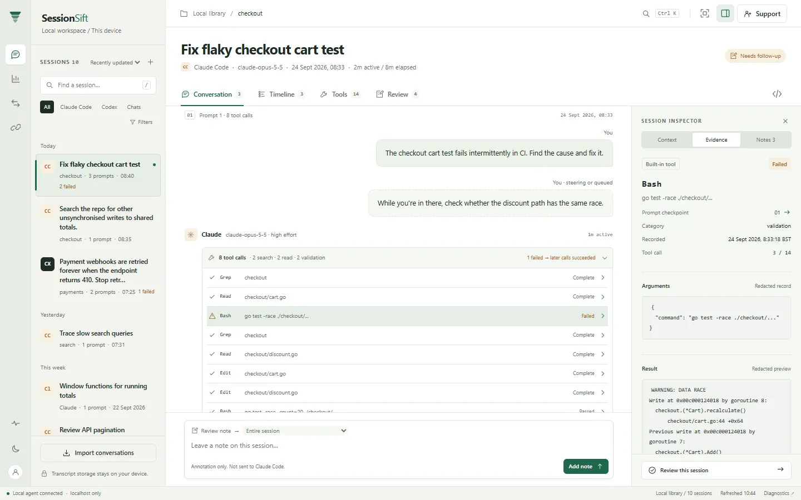

# SessionSift

Free, local-first conversation analysis for Codex, Claude Code and explicitly
imported ChatGPT/Claude exports. Browse conversations, inspect tokens and tools,
compare sessions and use ten read-only local MCP tools. No account, Google login,
bridge or cloud service is required. Findings point to evidence, not productivity scores.

**Version 2.1.0.** See [what this release includes](docs/release-candidate.md).
macOS binaries are unsigned and unnotarized; the published SHA-256 checksums
verify download integrity, not publisher identity. Do not disable Gatekeeper
globally.

Supported first-release platforms: macOS Intel (AMD64) and Linux AMD64 only.
Apple Silicon and Linux ARM64 are deferred; no ARM download or native support
is offered in this release.

## 1. Homebrew

Install from **LanceSandino/homebrew-tap**. The formula offers macOS Intel and
Linux amd64; ARM builds are not offered yet.

```bash
brew tap LanceSandino/tap
brew install LanceSandino/tap/sessionsift
sessionsift doctor
brew services start sessionsift
sessionsift status
sessionsift web
```

The service runs the existing foreground agent as your user, not root. No
`sudo` is needed. Alternatively run `sessionsift start` and leave that terminal
open; do not start both on the same port. For headless use, `sessionsift web
--no-browser` checks readiness and prints the loopback URL.

Stop and uninstall without deleting your library or source transcripts:

```bash
brew services stop sessionsift
brew uninstall sessionsift
```

Undo opted-in MCP configuration before uninstalling. Data remains in
`~/.sessionsift`; review and back up that directory before any separate deletion.

To update, stop the service and undo any configuration pinned
to the old Cellar executable, then upgrade and reapply the reviewed MCP setup:

```bash
brew services stop sessionsift
brew update
brew upgrade LanceSandino/tap/sessionsift
brew services start sessionsift
sessionsift doctor
```

Homebrew updates the installed package; there is no `sessionsift update` command.

### Release archive

Each [release](https://github.com/LanceSandino/sessionsift/releases) has
`sessionsift_<version>_darwin_amd64.tar.gz`, `sessionsift_<version>_linux_amd64.tar.gz`,
an SPDX inventory and `SHA256SUMS`. Verify and unpack, then run the binary:

```bash
shasum -a 256 -c SHA256SUMS --ignore-missing
tar -xzf sessionsift_2.1.0_darwin_amd64.tar.gz
./sessionsift_2.1.0_darwin_amd64/sessionsift doctor
```

## 2. Docker

Requires a maintained Docker Engine/Desktop (Engine at least 28.5.2) and Compose
v2.24.4+; see [security/version requirements](docs/docker-local.md). From this source directory:

```bash
docker compose --env-file /dev/null -f compose.local.yaml up -d --build
docker compose --env-file /dev/null -f compose.local.yaml ps
docker compose --env-file /dev/null -f compose.local.yaml exec -T agent /app/sessionsift doctor
```

Open <http://127.0.0.1:7777>. This locally built image uses a non-root/read-only
container and persistent named volume. No transcripts are mounted by default.
[Docker instructions](docs/docker-local.md) cover safe optional read-only mounts,
imports, Codex/Claude stdio MCP, permissions and teardown. The dedicated network
is not an outbound firewall. There is no published SessionSift image to pull yet.

```bash
docker compose --env-file /dev/null -f compose.local.yaml down
```

This preserves data. **Do not add `--volumes`.** Do not use private/operator
Compose files for consumer installation.

## 3. Build from Source

Use **Go 1.27.2** (`go.mod`), **Node.js 26** (tested with 26.9.0), npm and a source
copy with `LICENSE`/`NOTICE`. Locked test dependencies require Node
`^22.22.2 || ^24.15.0 || >=26.0.0`; older generic “Node 22+” is insufficient.
Dependency downloads initially require internet; app use does not. No private
skills, credentials or infrastructure are prerequisites.

```bash
git clone https://github.com/LanceSandino/sessionsift.git
cd sessionsift
```

```bash
npm ci
npm test
npm run build
./dist/sessionsift version
./dist/sessionsift doctor
./dist/sessionsift start
```

Leave `start` running; in another terminal:

```bash
./dist/sessionsift web
./dist/sessionsift import
./dist/sessionsift sessions
```

Ctrl-C or `./dist/sessionsift stop` stops the foreground agent. Removing the
build/check-out does not remove `~/.sessionsift` or transcripts. Keep required
license/notices when redistributing a permitted build.

## Use SessionSift

The [local guide](docs/local-guide.md) covers lifecycle, import/export files,
Conversation/Timeline/Tools/Review, inspection, comparison, backups and uninstall.
[MCP setup](docs/mcp-connection-guide.md) includes preview, explicit safe
configuration, verification and undo for local Codex and Claude Code.
`sessionsift setup mcp` still prints configuration without modifying files.
Hooks remain optional and disabled until explicitly enabled.

Default sources are Codex sessions/archives and Claude Code projects. Imports
are incremental. Missing optional sources and an empty library are normal.
Redaction is not a guarantee of secret-free records. AI clients you connect may
send tool output to their own provider; local MCP does not make that client
offline. Read the [privacy model](docs/privacy-and-threat-model.md). Never expose
or tunnel the Local Agent dashboard to a LAN or the internet.

Remote support, hosted MCP and encrypted cloud sync are **not offered in the
initial local-only release**. Preserved generic bridge source uses the same
binary, not another prerequisite or a promised public service. Advanced controls
are hidden until explicitly requested. [Basic self-host instructions](docs/self-host-operations.md)
apply only to deliberate use of that deferred functionality. Remote MCP is not
end-to-end encrypted.



The [screenshot tour](docs/screenshot-tour.md) contains demo data. Report
vulnerabilities privately through [SECURITY.md](SECURITY.md), never with real
transcripts or credentials in a public issue.

## License

Source-available under [PolyForm Noncommercial 1.0.0](LICENSE) with required
[NOTICE](NOTICE) attribution. Not OSI open source; commercial use is reserved.
Owner/legal disposition remains a publication prerequisite.
